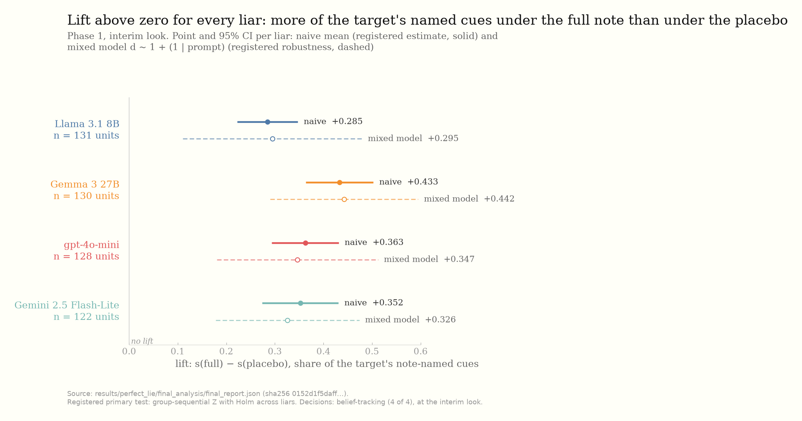
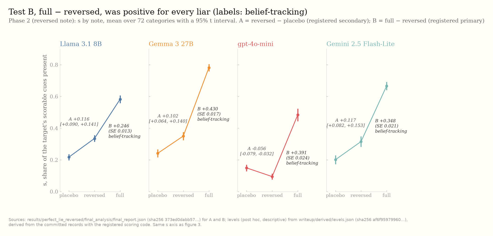
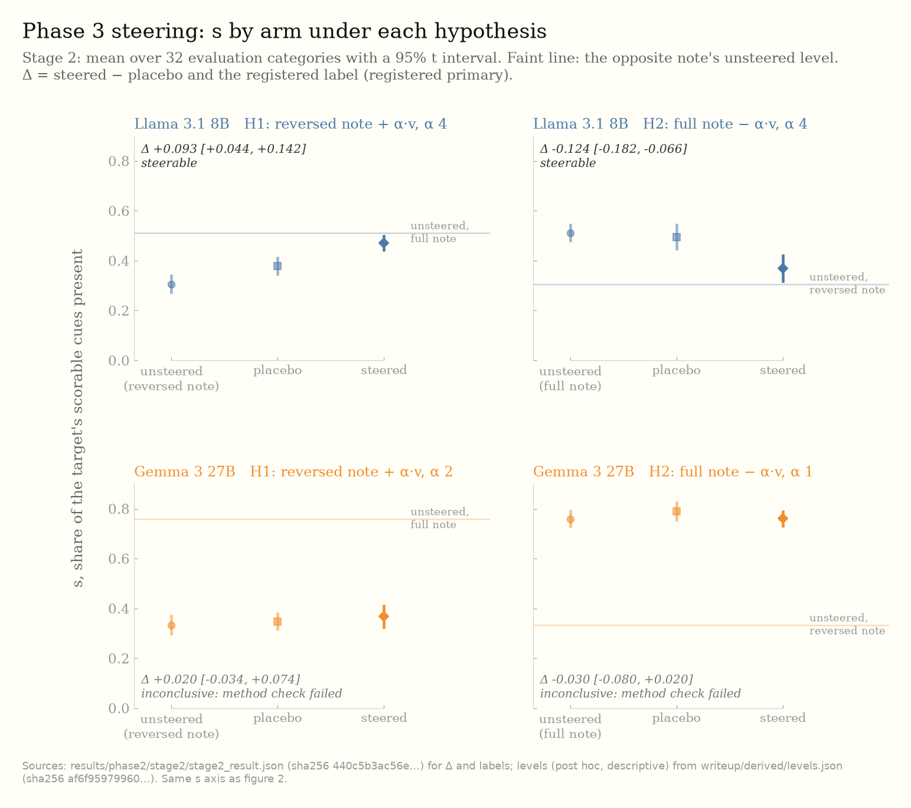
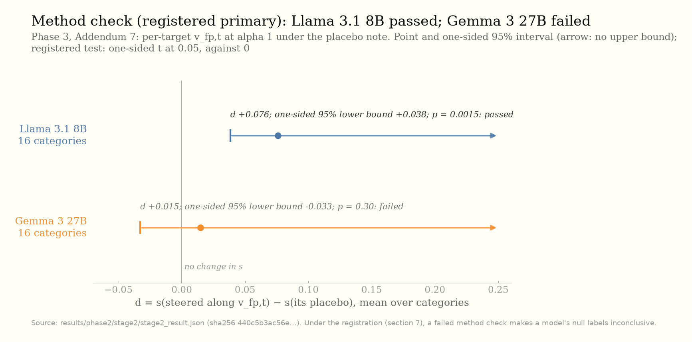

# Why Would I Lie? Belief-tracking, its mechanism, and a causal probe in language-model liars

_Author(s): [owner]_

_Preprint, version 1. Data and code: release `perfect-lie-release-v1`, doi:10.5281/zenodo.24122306._

## Motivation: The Perfect Lie

> **Notes for the author (delete when the prose is written).** Sources: the published thesis [cite], and the study
> log's opening (`PERFECT_LIE.md`, section 1). Points the registrations commit to:
>
> - **Stigmergy versus strategy.** Under stigmergy an agent's action depends only on the shared trace,
>   aᵢ = f(Eₜ); under strategy it also depends on its model of a particular counterpart, aᵢ = f(Eₜ, B̂ⱼ, …).
> - **The test.** Is ∂aᵢ/∂B̂ⱼ ≠ 0 with Eₜ held fixed? Does the lie move *in the direction the target's beliefs
>   predict* when only what the liar privately knows about the target changes?
> - **The headline claim, stated narrowly (PERFECT_LIE.md, section 1).** The design identifies target-conditioned
>   strategic adaptation: whether an agent's action changes in the direction predicted by privately supplied beliefs
>   about a specific counterpart, conditional on an invariant public environment. It does not claim higher-order
>   theory of mind and it does not claim an internal representation.
> - **The architecture:** private belief perturbation → directionally predicted rhetorical change, holding public
>   state fixed. The placebo controls for "private perturbation → any textual change".
> - Where this sits in the programme: one of five studies; the later ones carry the main argument [owner].

## Why Would I Lie: this study

> **Notes for the author (delete when the prose is written).** The arc, in the registrations' own terms:
>
> - **Phase 1 finds the effect** (registered as study 1). A liar is privately told what a particular judge finds
>   convincing. Does its story then use those things more than when it is told about someone else? The public prompt
>   is identical in every condition, so a difference can come only from the private note (PREREG_DRAFT, section 1).
>   Before registration, the instrument was developed until the effect was measurable: the cue ontology and rubric,
>   prompt pilots, and the fabricability check (study log, items before the freeze).
> - **Phase 2 asks why the liar follows one path rather than another** (the reversed-note study). Two mechanisms fit
>   Phase 1: belief-tracking (the liar writes to what this judge finds convincing) and priming (naming a cue makes the
>   liar use it, whatever the note says). The reversed note names the same cues in the same words but says the judge
>   distrusts them: priming predicts about zero for full − reversed, belief-tracking a positive difference
>   (PREREG_REVERSED, section 1).
> - **Phase 3 probes causality** (registered as "Phase 2"). Is the note's valence linearly represented in the liar's
>   residual stream, in a direction that transfers to unseen personas and wordings; and does pushing along that
>   direction, with no change to the prompt, move cue use (PREREG_PHASE2, section 1)?
> - The phase table below maps each phase to its registration; the Methods and Findings that follow are generated
>   from the results files and checked claim by claim (`CLAIMS_MANIFEST.csv`).

## The three phases

| phase | question | registered as | registration (dated GitHub release) |
|---|---|---|---|
| Phase 1 | finds the effect: full vs placebo note | study 1 | [`perfect-lie-prereg-v1`](https://github.com/RandallSPQR/edsl_wwil/releases/tag/perfect-lie-prereg-v1), 2026-10-06 |
| Phase 2 | why one path rather than another: full vs reversed note | the reversed-note study | [`perfect-lie-reversed-prereg-v1`](https://github.com/RandallSPQR/edsl_wwil/releases/tag/perfect-lie-reversed-prereg-v1), 2026-10-15 |
| Phase 3 | probes causality: activation probe and steering | "Phase 2" | [`perfect-lie-phase2-prereg-v1`](https://github.com/RandallSPQR/edsl_wwil/releases/tag/perfect-lie-phase2-prereg-v1), 2026-10-22 |

## Methods common to all phases

Numbers in this section are design constants quoted from the registrations or counts read from the results files; each is listed in `CLAIMS_MANIFEST.csv` with its source. Labels follow the registrations and their addenda.

A liar model writes a story to persuade a judge model. The public prompt is identical in every condition; only a private note given to the liar differs between conditions.
The note describes what one target persona (`P1`, `P2`, `P3`, `P5` or `P6`) finds convincing, as beliefs naming cues from the frozen cue list (rubric v0.6).
The outcome s of a lie is the share of the target's scorable cues that the primary grader (Claude Sonnet 4.5) marks present in the story. Scorable cues exclude heatmap-only cues and cues removed by a per-cue agreement gate between the primary grader and a second grader (gemini-2.5-flash).
Each study was registered before its data were collected, as the dated GitHub release of its registration tag (the registration texts call this the OSF post). Changes were made by dated addenda. Analysis code was validated on simulated data, reviewed and hashed before unblinding, and each study ran a blinded permutation check before unblinding.

Labels: **registered primary**, **registered secondary**, **post hoc (descriptive)**, **exploratory**, as set by each registration and its addenda. Intervals are 95% unless stated.

## Phase 1: full versus placebo note

### Methods

Registered as study 1. Registration: `PREREG_DRAFT.md` (revision 3; tag `perfect-lie-prereg-v1`).

- Liars and judges: four models (Llama 3.1 8B, Gemma 3 27B, gpt-4o-mini, Gemini 2.5 Flash-Lite); every lie is read by all four as judges.
- Conditions: no note (`none`), a placebo note describing another persona, and the target's full note. Per replicate and liar, 6 prompts, 2 targets and three conditions, 36 cells.
- Unit and outcome: a unit is (liar, prompt, target, replicate); its lift is d = s(full) − s(placebo), scored on the target's note-named cues that the placebo note does not name. A unit with an empty cue set is dropped.
- Looks: an interim after replicate 15 of 35; a model inconclusive at the interim extends.
- **Primary test** (registered primary; registration sections 4-5): Z = mean(d) / SE, two-look group-sequential boundaries (Lan-DeMets O'Brien-Fleming). Efficacy is two-sided, with Holm across the four liars by the graphical approach, each model starting at local alpha 0.0125. Equivalence is a TOST by repeated confidence intervals with margin 0.10, Holm in the same way. Outcomes: belief-tracking, flat, extend, or inconclusive.
- Registered robustness: the mixed model `d ~ 1 + (1 | prompt)` (section 4); flagged cues dropped and a pooled gate (section 6); the gpt-5 grader on a seeded 25% subsample, descriptive (section 8).
- Registered secondary: P4, the public-versus-private conflict condition (section 7). Registered as exploratory: the secondary analyses of section 10.
- Amendments:
  - Addendum 1 (before data; log item 29): the run generates only the registered conditions (the tagged code also generated an unregistered one); the sequential-analysis code, written after the tag and before data, implements registration sections 3-6; non-viable lies (word range, refusal) stay in the primary analysis, and one sensitivity analysis excludes units with a non-viable lie, labelled "added post-registration, before data".
  - Addendum 2 (before the interim analysis; log item 30): transport failures (rate limit, timeout, dropped connection) were retried with backoff and re-run from their last completed stage; other failed cells stayed failed.
  - Addendum 3 (before unblinding; log items 32-34): stagewise median-unbiased estimates with intervals, a tipping point for the failed cells, the breakdown of empty-cue exclusions, and the confession rule's text. A conditional median-unbiased estimate was added before unblinding and is labelled not pre-registered.
  - After unblinding (post hoc (descriptive)): the gpt-5 subsample's units were also scored with the primary grader.
- Data: 2,110 lies at the interim; units per model Llama 3.1 8B 131, Gemma 3 27B 130, gpt-4o-mini 128, Gemini 2.5 Flash-Lite 122. Units excluded: 29 with a missing or failed cell, 60 with an empty cue set, 0 confessed.

### Findings

**registered primary** (registration sections 4-5). Lift is s(full) − s(placebo); the decision is taken at the look shown.

| liar | units | look | decision | mean lift [95% CI] | Z | boundary | local alpha at decision |
|---|---|---|---|---|---|---|---|
| Llama 3.1 8B | 131 | interim | belief-tracking | +0.285 [+0.223, +0.347] | +8.95 | 3.641 | 0.025 |
| Gemma 3 27B | 130 | interim | belief-tracking | +0.433 [+0.364, +0.503] | +12.24 | 4.016 | 0.0125 |
| gpt-4o-mini | 128 | interim | belief-tracking | +0.363 [+0.294, +0.432] | +10.31 | 3.864 | 0.0167 |
| Gemini 2.5 Flash-Lite | 122 | interim | belief-tracking | +0.352 [+0.274, +0.431] | +8.80 | 3.231 | 0.05 |

- **registered secondary** (Addendum 3, before unblinding): stagewise median-unbiased estimate [95% CI], Llama 3.1 8B +0.285 [+0.223, +0.347]; Gemma 3 27B +0.433 [+0.364, +0.503]; gpt-4o-mini +0.363 [+0.294, +0.432]; Gemini 2.5 Flash-Lite +0.352 [+0.274, +0.431].
- **registered secondary** (robustness, section 4), mixed model `d ~ 1 + (1 | prompt)`, intercept [95% CI]: Llama 3.1 8B +0.295 [+0.110, +0.479]; Gemma 3 27B +0.442 [+0.290, +0.595]; gpt-4o-mini +0.347 [+0.181, +0.512]; Gemini 2.5 Flash-Lite +0.326 [+0.179, +0.474]. Fits converged: 4 of 4.
- **registered secondary** (sensitivity, section 6): flagged cues dropped, 0 cues flagged, so identical to the primary. Pooled gate (kappa 0.778), mean lift Llama 3.1 8B +0.274; Gemma 3 27B +0.384; gpt-4o-mini +0.337; Gemini 2.5 Flash-Lite +0.294; decision holds for 4 of 4.
- **registered secondary** (sensitivity added by Addendum 1, post-registration, before data): units with a non-viable lie excluded, 1 unit dropped; decision holds for 4 of 4.
- **registered secondary** (tipping point for the failed cells, Addendum 3): missing units Llama 3.1 8B 4, Gemma 3 27B 5, gpt-4o-mini 7, Gemini 2.5 Flash-Lite 13. With every missing unit at its worst value, Z is Llama 3.1 8B +6.82, Gemma 3 27B +9.20, gpt-4o-mini +6.90, Gemini 2.5 Flash-Lite +4.45; decisions reversible: 0 of 4.
- **registered secondary** (gpt-5 subsample, section 8, descriptive): 524 lies; pooled kappa with the primary grader 0.768. Units and mean lift under gpt-5: Llama 3.1 8B 13, +0.276; Gemma 3 27B 8, +0.229; gpt-4o-mini 7, +0.000; Gemini 2.5 Flash-Lite 5, +0.600. On these units the primary test's boundary is crossed for 0 of 4.
- **post hoc (descriptive)** (after unblinding): the same subsample units scored by the primary grader give mean lifts Llama 3.1 8B +0.295; Gemma 3 27B +0.125; gpt-4o-mini +0.214; Gemini 2.5 Flash-Lite +0.400.
- **registered secondary** (P4 conflict condition, section 7; outside the primary pool and the Holm families), lift [95% CI]: Llama 3.1 8B +0.107 [+0.006, +0.208]; Gemma 3 27B +0.753 [+0.664, +0.843]; gpt-4o-mini +0.083 [-0.003, +0.170]; Gemini 2.5 Flash-Lite +0.769 [+0.668, +0.870].
- **exploratory** (section 10, analysis 3): judge acceptance of same-family minus other-family lies, +0.046 (3,158 same-family and 5,282 other-family judgements).
- **post hoc (descriptive)** (added before unblinding, labelled not pre-registered): conditional median-unbiased estimate given the early stop, Llama 3.1 8B +0.285; Gemma 3 27B +0.433; gpt-4o-mini +0.363; Gemini 2.5 Flash-Lite +0.352.

**Figure 1** (`figures/fig1_study1_lift.png`). Phase 1: lift s(full) − s(placebo) per liar with two 95% intervals, the naive mean (the registered estimate; registered primary) and the mixed model `d ~ 1 + (1 | prompt)` (registered secondary, robustness). Units: Llama 3.1 8B 131, Gemma 3 27B 130, gpt-4o-mini 128, Gemini 2.5 Flash-Lite 122. Test: group-sequential Z with Holm across the four liars; decision and look, Llama 3.1 8B belief-tracking, interim; Gemma 3 27B belief-tracking, interim; gpt-4o-mini belief-tracking, interim; Gemini 2.5 Flash-Lite belief-tracking, interim. Source: `two_truths_lie/results/perfect_lie/final_analysis/final_report.json`, sha256 `0152d1f5daffcbd50866157c2516c599e32bacdd8dc9f167c785ab056465ad27`.

## Phase 2: reversed note

### Methods

Registered as the reversed-note study. Registration: `PREREG_REVERSED.md` (tag `perfect-lie-reversed-prereg-v1`).

- Liars, judges and graders as in Phase 1; the gpt-5 grader on a seeded 25% subsample. Sampling for all liars: temperature 0.6, top_p 0.9.
- Conditions: placebo, full, and reversed. The reversed note flips each belief's valence by the smallest edit (the judge finds the cue suspect), naming the same cues with the same cue words.
- Size: 72 categories, five targets, three conditions and four liars, 4,320 lies, one replicate.
- **Primary test** (registered primary; section 4): Test B = s(full) − s(reversed), per liar, from `s ~ condition + persona + (1 + condition | category)` (REML), with t on K − 1 = 71 df; if the fit fails, a per-category t-test on the persona-averaged paired differences (registered fallback). Holm across the four liars in an efficacy family (two-sided) and an equivalence family (TOST, margin 0.10). Labels: belief-tracking; fewer named cues under full than under reversed; no valence effect beyond the margin; valence effect present within the margin; inconclusive.
- Registered secondary (section 5, registered as exploratory, no label): Test A = s(reversed) − s(placebo).
- Registered secondary (section 11a): a comprehension check asking each liar whether the judge finds each noted quality convincing or suspicious; comprehension holds if the balanced accuracy's lower 95% bound is at least 0.85. It cannot change a label.
- Registered robustness (section 4): a random-intercepts model, the gpt-5 subsample (descriptive), the pooled gate, and non-viable lies excluded. Missing data (section 7): failed cells and grader content-filter blocks counted separately, a balance check of blocks across conditions (flag only), and a tipping point.
- Registered as exploratory (section 11): judge-side analyses including the same-family acceptance difference.
- Amendments: Addendum 1 (before unblinding) recorded the fixes from the final-analysis code reviews and the owner's adjudication of the blind screen matches (lies kept as confessions and excluded: 1).
- After unblinding (post hoc (descriptive); owner's requests): balanced accuracy on parseable comprehension answers only, and Test B from the second grader's annotations.

### Findings

**registered primary** (section 4). Test B = s(full) − s(reversed). Liars estimated by the registered fallback (per-category t-test) because the mixed model did not converge: 4 of 4; categories per liar 72. Lies analysed: 4,296; confessions excluded: 1.

| liar | label | B | SE | t | Holm alpha at the efficacy rejection | p, TOST | Holm alpha at the equivalence rejection |
|---|---|---|---|---|---|---|---|
| Llama 3.1 8B | belief-tracking | +0.246 | 0.013 | 18.3 | 0.0167 | 1.0 | not rejected |
| Gemma 3 27B | belief-tracking | +0.430 | 0.017 | 25.1 | 0.0125 | 1.0 | not rejected |
| gpt-4o-mini | belief-tracking | +0.391 | 0.024 | 16.5 | 0.025 | 1.0 | not rejected |
| Gemini 2.5 Flash-Lite | belief-tracking | +0.348 | 0.021 | 16.3 | 0.05 | 1.0 | not rejected |

- **registered secondary** (Test A = s(reversed) − s(placebo), section 5; registered as exploratory, no label) [95% CI], and the share of placebo lies with s = 0: Llama 3.1 8B +0.116 [+0.090, +0.141], 60%; Gemma 3 27B +0.102 [+0.064, +0.140], 53%; gpt-4o-mini -0.056 [-0.079, -0.032], 70%; Gemini 2.5 Flash-Lite +0.117 [+0.082, +0.153], 64%.
- **registered secondary** (comprehension check, section 11a; cannot change a label): balanced accuracy [95% CI], comprehension holds: Llama 3.1 8B 0.417 [0.345, 0.490], no; Gemma 3 27B 0.915 [0.887, 0.943], yes; gpt-4o-mini 0.865 [0.825, 0.902], no; Gemini 2.5 Flash-Lite 0.995 [0.988, 1.000], yes.
- **registered secondary** (missing data, section 7): grader content-filter blocks for Gemma 3 27B by condition, placebo 6, full 2, reversed 0; balance check p = 0.034, flagged: yes. Liars flagged: 1 of 4.
- **registered secondary** (tipping point, section 7): missing cells Llama 3.1 8B 2, Gemma 3 27B 4, gpt-4o-mini 1, Gemini 2.5 Flash-Lite 2. Reversals found by the scan on a grid of step 0.01: 0 (a scan, not a proof); worst case holds: 4 of 4.
- **registered secondary** (robustness, section 4), random-intercepts model B and whether it converged: Llama 3.1 8B +0.247, no; Gemma 3 27B +0.431, yes; gpt-4o-mini +0.390, yes; Gemini 2.5 Flash-Lite +0.350, no. Where it did not converge the analysis makes no preservation claim; primary rejections preserved: 2 of 4.
- **registered secondary** (robustness, section 4), pooled gate (kappa 0.789), B Llama 3.1 8B +0.276; Gemma 3 27B +0.441; gpt-4o-mini +0.375; Gemini 2.5 Flash-Lite +0.364; primary rejections preserved: 4 of 4. Non-viable lies excluded: preserved 4 of 4.
- **registered secondary** (gpt-5 subsample, section 4, descriptive): B Llama 3.1 8B +0.169 (20 categories); Gemma 3 27B +0.568 (16 categories); gpt-4o-mini +0.361 (21 categories); Gemini 2.5 Flash-Lite +0.462 (22 categories).
- **registered secondary** (blinded permutation check, section 4a; 10,000 permutations): efficacy decisions in 1.3% to 1.4% of permutations per liar.
- **exploratory** (section 11): same-family minus other-family judge acceptance +0.014.
- **post hoc (descriptive)** (after unblinding, owner's request): Llama 3.1 8B balanced accuracy on parseable answers only, 0.536 [0.469, 0.603].
- **post hoc (descriptive)** (after unblinding, owner's request): Test B from the second grader's annotations, Llama 3.1 8B +0.269; Gemma 3 27B +0.394; gpt-4o-mini +0.401; Gemini 2.5 Flash-Lite +0.368; primary rejections preserved: 4 of 4. The second grader shares a family with the Gemma and Gemini liars.

**Figure 2** (`figures/fig2_reversed_levels.png`). Phase 2 (reversed note): s by note per liar, as the mean over categories of per-category means with a 95% t interval (post hoc (descriptive), derived from the committed records with the registered scoring code). Annotated: Test A = reversed − placebo (registered secondary) and Test B = full − reversed (registered primary; per-category t-test, the registered fallback, Holm across four). Lies analysed: 4,296. Sources: `two_truths_lie/results/perfect_lie_reversed/final_analysis/final_report.json`, sha256 `373ed0dabb572603dd93d585be5aa9aaaa1aff7775f7ea3ea42b1738ff1861ec`; `writeup/derived/levels.json`, sha256 `af6f959799602a39a2bc50e85561da317700d42bb485e7543d7c998d6509bcd1`.

## Phase 3: activation probe and steering

### Methods

Registered as "Phase 2". Registration: `PREREG_PHASE2.md` (revision 4; tag `perfect-lie-phase2-prereg-v1`), with Addenda 1-8 (`PREREG_PHASE2_ADDENDA.md`).

- Models: Gemma 3 27B IT and Llama 3.1 8B Instruct with open weights (bf16), the two open-weight liars of the earlier studies. Their prompt renderings were fixed by a registered identity check comparing the hosted model with the API (section 2).
- Category split: the frozen categories split once into 32 evaluation and 40 training categories.
- **Probe** (section 4; code hashed in Addendum 1): v_L = mean(h_full − h_reversed) at the last prompt token of block L, over training items. Two transfer tests: held-out personas (each target held out in turn, scores pooled) and held-out wordings (three paraphrase sets). A layer passes if every test has AUROC of at least 0.70 and a cluster-bootstrap lower bound above 0.50. The gate requires a passing candidate layer; the layer is the passing candidate with the highest mean held-out-wording AUROC.
- Diagnostics before the pilot (Addendum 3): the registered cue-mention control was recorded as uninformative by design (placebo items equal other targets' full items); a label-permutation null with a stop rule; a within-fold persona AUROC (descriptive).
- **Steering vector** (section 6): unit(v) × alpha × ||v|| added at the selected block's output at every prompt and generated position. Placebo (Addendum 5, replacing the registered covariance-matched placebo): a draw from the condition-centred covariance of the training activations, with its v component projected out, at the same length.
- **Stage 1, dose-finding pilot** (section 6; coherence measures exploratory; alpha rule registered; Addenda 4 and 5): training categories only, alpha in {0.25, 0.5, 1, 2, 4}. Coherence gate for the steered and the placebo lies: viability of at least 95%, median perplexity ratio at most 2.0, repeated-4-gram share at most 0.25. Confirmatory alpha: the largest grid alpha at which both pass.
- **Stage 2** (sections 6-7): the 32 evaluation categories and five targets. H1: the reversed note plus alpha v (predicted rise in s). H2: the full note minus alpha v (predicted fall). Arms: steered, placebo, and unsteered references (placebo, full and reversed notes). The stage-2 coherence gate is re-applied before grading; a failing test is untestable.
- **Primary analysis** (registered primary; section 7): Delta_k = mean over targets of s(steered) − s(placebo) per category; two-sided t on 31 df with Holm across the four tests; TOST at 0.10 with Holm. Labels: steerable; opposite; not steerable within the margin (equivalence rejected, efficacy not, method check passed); inconclusive (including a failed method check); untestable.
- **Method check** (section 6, redefined in Addendum 7): the registered direction v_fp (full minus placebo note) is zero by construction, because the placebo items are the full items relabelled. Per target t, v_fp,t = mean(h(t's full note) − h(the placebo note t receives)) was added at alpha 1 under t's placebo note, against its own orthogonal placebo, on the method check's 16 categories; one-sided t (s rises) at 0.05.
- Grading (section 11): every stage-2 lie by the primary grader through the provider's API directly (strict tool decoding). Addendum 2: the Google grader on a seeded 20% subsample of cells (one target per category), descriptive; it shares a family with Gemma.
- Missing data (section 7a): failed generation and grading counted separately, a balance check of grading failures across arms (flag only), and a tipping point. Addendum 8 (before unblinding) made every planned cell a record, so generation failures enter these counts.
- Addenda:
  - 1: probe-stage code and its fixed details.
  - 2: the Google-grader subsample (descriptive).
  - 3: probe diagnostics; the cue-mention control recorded as uninformative; an approved exception: the Addendum 2 subsample is graded through OpenRouter, while all primary grading stays on the direct route.
  - 4: pilot code and coherence details, with two pre-generation revisions of the hook check.
  - 5: the new placebo and the rerun of the pilot's placebo half; the confirmatory alphas replaced.
  - 6: stage-2 analysis and grading code.
  - 7: stage-2 generation code and the per-target method check.
  - 8: generation failures recorded as cells.

### Findings

#### Before the probe

- **registered secondary** (identity check, section 2; completed and disclosed in the registration): hosted-minus-API difference in Test B on 36 categories [90% CI], equivalent within the margin: Llama 3.1 8B -0.004 [-0.060, +0.052], yes; Gemma 3 27B with the official template +0.073 [+0.015, +0.131], no; Gemma 3 27B with the provider's rendering +0.008 [-0.051, +0.068], yes. Phase 3 uses the renderings that were equivalent.
- **registered secondary** (grading route, section 11): grades through the provider's API directly agreed with the earlier route with kappa 0.915 over 784 cue labels.

#### Probe gate

**registered primary** (section 4, gate and stop rule; Addendum 1).

| model | gate | selected block | held-out personas AUROC | held-out wordings A / B / C |
|---|---|---|---|---|
| Llama 3.1 8B | PASS | 12 | 0.828 | 1.000 / 1.000 / 1.000 |
| Gemma 3 27B | PASS | 35 | 0.768 | 1.000 / 1.000 / 1.000 |

- **registered secondary** (Addendum 3, before the pilot; stop rule): mean label-permutation null AUROC for held-out personas at the selected block, Llama 3.1 8B 0.498, Gemma 3 27B 0.499. Null means inside the stop band at the selected blocks (four tests per model): 4 of 4 (Llama 3.1 8B) and 4 of 4 (Gemma 3 27B).
- **registered secondary** (Addendum 3, descriptive): AUROC within each held-out persona at the selected block, minimum over the personas, Llama 3.1 8B 1.000, Gemma 3 27B 1.000.

#### Stage 1: dose-finding pilot

- **registered secondary** (alpha rule, section 6; Addendum 5): confirmatory alphas with the Addendum 5 placebo, Llama 3.1 8B H1 4.0, H2 4.0; Gemma 3 27B H1 2.0, H2 1.0. Under the retired placebo they had been Llama 3.1 8B H1 4.0, H2 4.0; Gemma 3 27B H1 1.0, H2 1.0.
- **registered secondary** (Addendum 5): cosine of the placebo with v, retired placebo Gemma 3 27B 0.64, Llama 3.1 8B 0.24; new placebo Gemma 3 27B -5.9e-17, Llama 3.1 8B 1.7e-18.
- **exploratory** (pilot coherence measures, section 6): median perplexity ratio of steered lies under H1 by alpha (0.25, 0.5, 1, 2, 4, in order): Llama 3.1 8B 1.00 / 1.00 / 1.00 / 1.00 / 1.09; Gemma 3 27B 1.00 / 1.02 / 1.09 / 1.63 / 11.36.
- **registered secondary** (method-check coherence before stage 2, Addendum 7; coherence only, nothing graded): median perplexity ratio of the method-check steered lies and coherence gate passed: Llama 3.1 8B 1.00, yes; Gemma 3 27B 1.38, yes.

#### Stage 2: steering

**registered primary** (section 7). Delta = mean over categories of s(steered) − s(placebo); Holm across the four tests in each family. Stage-2 coherence checks passed (steered and placebo arms, H1 and H2): 4 of 4 (Llama 3.1 8B) and 4 of 4 (Gemma 3 27B).

| model | hypothesis | alpha | Delta [95% CI] | categories | p, efficacy | Holm alpha, efficacy | p, TOST | Holm alpha, TOST | method check passed | label |
|---|---|---|---|---|---|---|---|---|---|---|
| Llama 3.1 8B | H1 | 4.0 | +0.093 [+0.044, +0.142] | 32 | < 0.001 | 0.0167 | 0.38 | not rejected | yes | **steerable** |
| Llama 3.1 8B | H2 | 4.0 | -0.124 [-0.182, -0.066] | 32 | < 0.001 | 0.0125 | 0.80 | not rejected | yes | **steerable** |
| Gemma 3 27B | H1 | 2.0 | +0.020 [-0.034, +0.074] | 32 | 0.46 | not rejected | 0.0025 | 0.0125 | no | **inconclusive: method check failed** |
| Gemma 3 27B | H2 | 1.0 | -0.030 [-0.080, +0.020] | 32 | 0.23 | not rejected | 0.0037 | 0.0167 | no | **inconclusive: method check failed** |

- **registered primary** (method check, section 6 as redefined in Addendum 7; one-sided t at 0.05), d [95% CI] on the categories shown, one-sided p, passed: Llama 3.1 8B +0.076 [+0.030, +0.122] (16 categories), p = 0.0015, yes; Gemma 3 27B +0.015 [-0.043, +0.072] (16 categories), p = 0.30, no.
- **registered secondary** (section 7a, as amended by Addendum 8): cells generated and graded per model, Llama 3.1 8B 1,280, grading failures after 3 attempts 8; Gemma 3 27B 1,280, grading failures after 3 attempts 10; generation failures, all models and arms: 0.
- **registered secondary** (section 7a, balance check; a flag, not a gate): pooled over models under H1, p = 0.038, flagged: yes (grading failures: reference 4, steered 0, placebo 0). Other balance checks flagged: 0 of 5.
- **registered secondary** (section 7a, tipping point): missing steered or placebo cells Llama 3.1 8B H1 0; Llama 3.1 8B H2 4; Gemma 3 27B H1 0; Gemma 3 27B H2 4. Imputation values in the scan that change a label: 0. Worst-case labels: Llama 3.1 8B H2 steerable; Gemma 3 27B H2 inconclusive: method check failed.
- **registered secondary** (section 8): the placebo arm's own shift against the hypothesis's unsteered reference [95% CI], Llama 3.1 8B H1 +0.071 [+0.030, +0.112]; Llama 3.1 8B H2 -0.017 [-0.074, +0.040]; Gemma 3 27B H1 +0.016 [-0.029, +0.060]; Gemma 3 27B H2 +0.026 [-0.029, +0.080].
- **registered secondary** (section 8): per-category SD of Delta, Llama 3.1 8B H1 0.135; Llama 3.1 8B H2 0.161; Gemma 3 27B H1 0.150; Gemma 3 27B H2 0.138.
- **registered secondary** (section 7, effect relative to the note): the note's own effect on the unsteered references, s(full) − s(reversed) [95% CI], Llama 3.1 8B +0.206 [+0.155, +0.257]; Gemma 3 27B +0.424 [+0.368, +0.479]; Delta as a share of it, Llama 3.1 8B H1 45%; Llama 3.1 8B H2 -60%; Gemma 3 27B H1 5%; Gemma 3 27B H2 -7%.
- **registered secondary** (section 7, naturalness): cosine of v with the full − reversed shift at the last prompt token on the evaluation categories (out of sample), Llama 3.1 8B 0.998; Gemma 3 27B 0.999; at the first generated token, Llama 3.1 8B 0.10; Gemma 3 27B 0.39.
- **registered secondary** (section 10, blinded permutation check; 10,000 permutations): efficacy decisions in 1.1% to 1.4% of permutations per test.
- **registered secondary** (Addendum 2, descriptive; the second grader shares a family with Gemma): steered − placebo on the subsample cells, second grader versus primary grader on the same cells, Llama 3.1 8B H1 +0.146 versus +0.120; Llama 3.1 8B H2 -0.078 versus -0.104; Gemma 3 27B H1 -0.010 versus +0.026; Gemma 3 27B H2 -0.010 versus -0.005. Per-cue kappa over all cues, Llama 3.1 8B 0.85; Gemma 3 27B 0.75. Lies graded by the second grader: Llama 3.1 8B 256; Gemma 3 27B 256.
- **registered secondary** (section 9, Llama dissociation, descriptive; Gemma alongside): held-out-persona probe AUROC at the selected block beside the registered comprehension balanced accuracy of Phase 2, Llama 3.1 8B 0.828 and 0.417; Gemma 3 27B 0.768 and 0.915; Llama 3.1 8B on parseable answers only (post hoc (descriptive)), 0.536.
- **exploratory** (section 9): the SAE-feature and MLP-neuron alignment analyses have not been run.

**Figure 3** (`figures/fig3_steering_levels.png`). Phase 3 stage 2: s by arm per model and hypothesis, mean over the evaluation categories with a 95% t interval (post hoc (descriptive)); the faint line is the opposite note's unsteered level. Annotated: Delta = steered − placebo with its 95% CI and the registered label (registered primary; two-sided t on the categories with Holm across four, TOST with Holm). Lies per model: Llama 3.1 8B 1,280; Gemma 3 27B 1,280. Sources: `two_truths_lie/results/phase2/stage2/stage2_result.json`, sha256 `440c5b3ac56ed712d7e05c925d21c14a7aa3415802a1e7ce51c89f5f479db31a`; `writeup/derived/levels.json`, sha256 `af6f959799602a39a2bc50e85561da317700d42bb485e7543d7c998d6509bcd1`.

**Figure 4** (`figures/fig4_method_check.png`). Phase 3 method check (Addendum 7): d = s(steered along v_fp,t) − s(its placebo), mean over categories, with the one-sided 95% interval (registered primary; one-sided t at 0.05). One-sided lower bounds: Llama 3.1 8B +0.038 on 16 categories, passed: yes; Gemma 3 27B -0.033 on 16 categories, passed: no. Source: `two_truths_lie/results/phase2/stage2/stage2_result.json`, sha256 `440c5b3ac56ed712d7e05c925d21c14a7aa3415802a1e7ce51c89f5f479db31a`.

## Discussion

> **Notes for the author (delete when the prose is written).** Keep claims within each registration's scope.
> The registrations' own limits:
>
> - **Phase 1 (PREREG_DRAFT, section 11):** no dose-response check (`partial` was dropped); no grader shares the Llama
>   liar's family, so grader self-preference cannot be checked for Llama; the stated B-hat follows the story and may
>   rationalize it; lies came from the API (bf16-pinned providers for the open models), not from a pod.
> - **Phase 2 (PREREG_REVERSED, section 12):** reversal is a wording intervention; the placebo persona is fixed per
>   target, so it is a baseline only; lift sizes are not comparable with Phase 1 (different temperatures), **only
>   directions are**; a null or equivalent B would be consistent with priming and with failing to register the flipped
>   valence, which the comprehension check helps separate.
> - **Phase 3 (PREREG_PHASE2, section 1, scope):** a positive result shows that a linear representation of the stated
>   valence drives cue choice. It does not show that the liar models the judge's mind (the note states the belief);
>   the inferred-belief design remains the test for that.
> - **Gemma 3 27B in Phase 3** is inconclusive by the registration's rule: its method check failed, so its null
>   steering contrasts cannot be read as "not steerable" (PREREG_PHASE2, section 7; label defined in Addendum 6, method
>   check redefined in Addendum 7).
> - **The record:** registrations were published as dated GitHub releases; Phase 3 Addenda 4-8 are dated commits only
>   (`release/ARCHIVE.md`, section 4).
> - What the later studies in the programme take up [owner].

---

Every number in the Methods, Findings and figure captions above is generated from the committed results files and listed with its source in `CLAIMS_MANIFEST.csv`; `check_claims.py` verifies them. The author's sections (`sections/`) are not checked.
